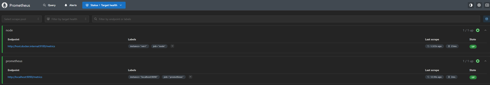
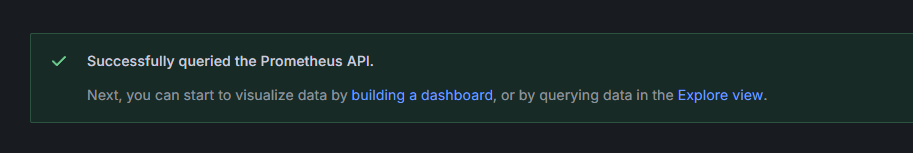
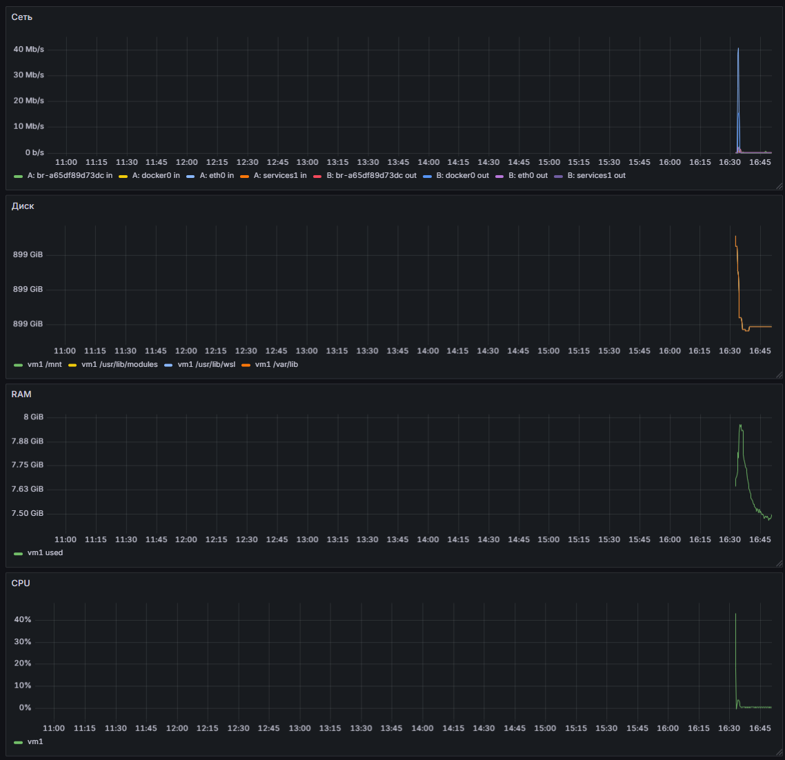

# ДЗ 3: мониторинг и Docker

## Задание 1. Мониторинг

Файлы: `monitoring/compose.yaml`, `monitoring/prometheus/prometheus.yml`, `monitoring/grafana/dashboard.json`.

В `prometheus.yml` добавил задание `node`:

```yaml
  - job_name: node
    static_configs:
      - targets: [host.docker.internal:9100]
        labels:
          instance: vm1
```

У меня Docker Desktop, и сначала Prometheus не видел node-exporter (`connection refused`).

Запуск и проверка:

```console
$ cd monitoring && docker compose up -d
$ docker compose ps
NAME                         IMAGE                       STATUS          PORTS
monitoring-grafana-1         grafana/grafana:12.1.0      Up 42 minutes   127.0.0.1:3000->3000/tcp
monitoring-node-exporter-1   prom/node-exporter:v1.9.1   Up 42 minutes
monitoring-prometheus-1      prom/prometheus:v3.5.0      Up 42 minutes   127.0.0.1:9090->9090/tcp

$ curl -s localhost:9100/metrics | grep -E '^node_(memory_MemAvailable|cpu_seconds_total\{cpu="0",mode="(idle|user)")'
node_cpu_seconds_total{cpu="0",mode="idle"} 183393.65
node_cpu_seconds_total{cpu="0",mode="user"} 251.37
node_memory_MemAvailable_bytes 8.01898496e+09

$ curl -s 'localhost:9090/api/v1/query?query=up{job="node"}'
{"status":"success","data":{"resultType":"vector","result":[{"metric":{"__name__":"up","instance":"vm1","job":"node"},"value":[1791728102.956,"1"]}]}}
```

Цель `vm1` в Prometheus:



Источник данных в Grafana (URL `http://prometheus:9090`):



Дашборд с переменной `instance` и четырьмя панелями. Во всех запросах есть фильтр `{instance=~"$instance"}`.

| Панель | Запрос |
| ------ | ------ |
| CPU, % | `100 * (1 - avg by (instance) (rate(node_cpu_seconds_total{mode="idle", instance=~"$instance"}[$__rate_interval])))` |
| RAM, байты | `node_memory_MemTotal_bytes{instance=~"$instance"} - node_memory_MemAvailable_bytes{instance=~"$instance"}` |
| Диск, байты | `node_filesystem_avail_bytes{instance=~"$instance", fstype!~"tmpfs\|9p\|overlay\|squashfs"}` |
| Сеть, бит/с | `rate(node_network_receive_bytes_total{instance=~"$instance", device!~"lo\|veth.*"}[$__rate_interval]) * 8` и то же для `transmit` |



## Задание 2. Docker-образ для counter-backend

Dockerfile лежат в `counter-backend/`: `Dockerfile.single`, `Dockerfile.multistage`, `Dockerfile.nonroot`.

Одно отличие от команд из задания: вместе с Poetry ставлю `poetry-plugin-export`.
В Poetry 2.x без этого плагина нет команды `poetry export`.

Сборка:

```console
$ cd counter-backend
$ docker build -f Dockerfile.single -t counter-backend:single .
$ docker build -f Dockerfile.multistage -t counter-backend:multistage .
$ docker build -f Dockerfile.nonroot -t counter-backend:nonroot .
```

### single

```console
$ docker run -d --rm --name cb-single -p 127.0.0.1:18081:8080 counter-backend:single
$ curl -s localhost:18081/api/counter
{"count": 0}
$ curl -si -X POST localhost:18081/api/counter | sed -n '1p;$p'
HTTP/1.1 201 Created
{"count": 1}
$ curl -si -X POST localhost:18081/api/counter | sed -n '1p;$p'
HTTP/1.1 201 Created
{"count": 2}
$ docker exec cb-single id
uid=0(root) gid=0(root) groups=0(root)
```

### multistage

```console
$ docker run -d --rm --name cb-multistage -p 127.0.0.1:18082:8080 counter-backend:multistage
$ curl -s localhost:18082/api/counter
{"count": 0}
$ curl -si -X POST localhost:18082/api/counter | sed -n '1p;$p'
HTTP/1.1 201 Created
{"count": 1}
$ curl -si -X POST localhost:18082/api/counter | sed -n '1p;$p'
HTTP/1.1 201 Created
{"count": 2}
$ docker exec cb-multistage id
uid=0(root) gid=0(root) groups=0(root)
```

### nonroot

```console
$ docker run -d --rm --name cb-nonroot -p 127.0.0.1:18083:8080 counter-backend:nonroot
$ curl -s localhost:18083/api/counter
{"count": 0}
$ curl -si -X POST localhost:18083/api/counter | sed -n '1p;$p'
HTTP/1.1 201 Created
{"count": 1}
$ curl -si -X POST localhost:18083/api/counter | sed -n '1p;$p'
HTTP/1.1 201 Created
{"count": 2}
$ docker exec cb-nonroot id
uid=1001(user) gid=1001(user) groups=1001(user),100(users)
```

### Размеры образов

```console
$ docker image ls counter-backend --format 'table {{.Repository}}:{{.Tag}}\t{{.Size}}'
REPOSITORY:TAG               SIZE
counter-backend:nonroot      234MB
counter-backend:multistage   234MB
counter-backend:single       380MB
```

| Образ | Размер | Пользователь |
| ----- | ------ | ------------ |
| single | 380 MB | root |
| multistage | 234 MB | root |
| nonroot | 234 MB | user (1001) |

Многоступенчатый образ меньше на 146 MB, потому что в него не попадает Poetry.
У nonroot размер почти такой же, как у multistage: добавился только пользователь.
